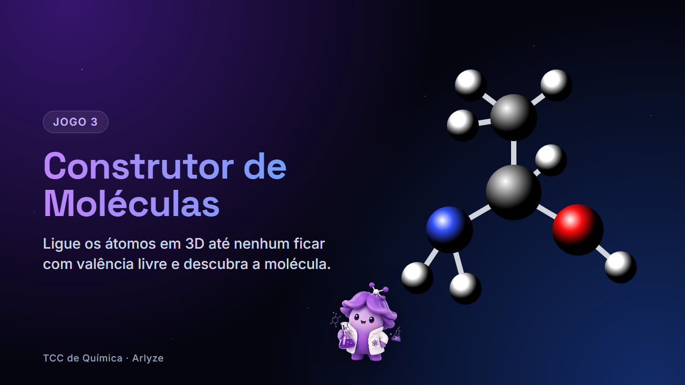

# Construtor de Moléculas



Jogo educativo de Química (TCC) em que o aluno monta moléculas em **3D** ligando átomos. A molécula fica pronta quando nenhum átomo tem valência livre. Quando ela é montada, o jogo mostra os dados reais da molécula vindos da **PubChem**.

## Como rodar

Precisa de **Python 3** e internet (para a PubChem e as bibliotecas via CDN).

```bash
python server.py
```

Abra **http://localhost:8000** no navegador.

> O jogo é só HTML/JS: a PubChem é consultada direto do navegador. Por isso ele também funciona hospedado na **Vercel** (ou qualquer hospedagem estática). O `server.py` é só um servidor local.

## Como jogar

1. **Clique num átomo** e depois em outro para fazer uma ligação.
2. Ligue os mesmos dois átomos de novo para fazer uma **ligação dupla ou tripla**.
3. **Clique numa ligação** para desfazê-la.
4. **Arraste o fundo** para girar a molécula e use **+ / −** para o zoom.
5. As **bolinhas amarelas** são os conectores livres. Quando acabam, a molécula está completa.

Na primeira vez, um tutorial com a Arly ensina tudo montando a água (H₂O). Ele pode ser aberto de novo em **Como jogar**.

## Blocos

| Bloco | Conteúdo |
|---|---|
| Inorgânicos | H₂O, NH₃, CO₂, HCl... |
| Hidrocarbonetos e haletos | alcanos, alcenos, benzeno, clorofórmio... |
| Álcoois | metanol, etanol, propanóis, glicerol... |
| Ácidos | ácidos carboxílicos (acético, cítrico...) |
| Aminoácidos | glicina, alanina, serina... |
| Outras funções orgânicas | aldeídos, cetonas, éteres, ésteres, aminas, tióis |

Cada bloco é **infinito**: as moléculas vêm em baralho, da mais fácil à mais difícil, e só se repetem depois de saírem todas.

**Isômeros:** quando duas moléculas têm a mesma fórmula, o jogo confere a estrutura. Por exemplo, ele sabe se o O–H do propanol está na ponta ou no meio da cadeia e dá uma dica quando a estrutura está errada.

## Arquivos

| Arquivo | O que faz |
|---|---|
| `index.html` | Página e estilos (Tailwind, Lucide e Three.js via CDN) |
| `jogo.js` | Cena 3D, física das ligações, painel, tutorial e fluxo do jogo |
| `moleculas.js` | Banco de moléculas, valências, regras de isômeros e regras de cada bloco |
| `server.py` | Servidor local para testar no computador |
| `arly.png` | Mascote |

## Adicionar uma molécula

Em `moleculas.js`, dentro do bloco certo:

```js
m('C2H6O', 'Etanol', 'ethanol', [temOH, 'O etanol tem o grupo O–H.'])
//  fórmula   nome     nome em inglês (PubChem)   regra de estrutura opcional + dica
```

Ao abrir o jogo, um **autoteste** confere no console do navegador (F12) se cada molécula:
- é possível de montar (soma de valências par);
- está no **bloco correto** (regras em `ACEITA`).

O progresso (moléculas montadas por bloco e se o tutorial já foi visto) fica salvo no `localStorage` do navegador.
